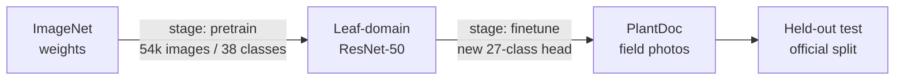

# Transfer Learning — Plant Disease Classification with ResNet-50


Fine-tunes a ResNet-50 across two stages: ImageNet → PlantVillage (lab imagery), then
PlantVillage → PlantDoc (real field photographs). The second stage is the one that
matters — it measures whether learning from 54 k clean lab images actually transfers to
2.6 k messy phone photos of plants in situ.

Companion repo: [CUSTOM-CNN-MODEL](https://github.com/Anandhasasidharan/CUSTOM-CNN-MODEL)
— a from-scratch custom CNN and the three-stage baseline comparison.

---

## Pipeline



| Stage | Init | Training data | Output |
|---|---|---|---|
| `pretrain` | ImageNet (`IMAGENET1K_V1`) | PlantVillage `color/`, 54,306 img / 38 classes | Domain-adapted backbone |
| `finetune` | Stage-1 checkpoint | PlantDoc `train/`, 2,096 img / 27 classes | Final classifier |

---

## Expected results

| Stage | Dataset | Classes | Expected accuracy |
|---|---|---|---|
| `pretrain` | PlantVillage | 38 | 98–99 % *(saturated — see note)* |
| `finetune` | PlantDoc (official test split) | 27 | **85–92 %** |

> PlantVillage is lab photography — saturated at 98–99 % and not meaningful on its own.
> It exists to produce features. The defensible number is the `finetune` stage on
> PlantDoc's held-out test split, which is a genuine by-farm split rather than a random
> sample of one augmented pool.

---

## Dataset

Two public datasets under one root:

```
D:\AI\DATASET\                          # override with PLANT_DATA_DIR
├── PlantVillage-Dataset\color\           # flat: Crop___Disease/*.JPG
└── PlantDoc-Dataset\
    ├── train\<class>\*.jpg
    └── test\<class>\*.jpg
```

```bash
cd D:\AI\DATASET
git clone https://github.com/spMohanty/PlantVillage-Dataset
git clone https://github.com/pratikkayal/PlantDoc-Dataset
```

| Dataset | Images | Classes | Character |
|---|---|---|---|
| [PlantVillage](https://github.com/spMohanty/PlantVillage-Dataset) | 54,306 | 38 | Single leaf, uniform background, lab light |
| [PlantDoc](https://github.com/pratikkayal/PlantDoc-Dataset) | 2,598 | 27 | Real field photos, clutter, shadow, imbalance |

---

## Quickstart

```bash
pip install torch torchvision scikit-learn matplotlib tqdm \
  --index-url https://download.pytorch.org/whl/cu126

# 1. domain pretraining (optional but this is what makes the transfer work)
python train.py --stage pretrain

# 2. transfer onto field imagery
python train.py --stage finetune

# 3. evaluate on PlantDoc's official test split
python evaluate.py --stage finetune
```

Override anything without editing source:

```bash
python train.py --stage finetune --arch resnet18 --epochs 15 --batch-size 32
python train.py --stage finetune --no-init          # ImageNet only, skip stage 1
python evaluate.py --checkpoint outputs/finetune/best_model.pth
```

**GPU memory.** ResNet-50 at 224 px, batch 64 needs roughly 8 GB. On a smaller card use
`--arch resnet18` (11 M params) or `--batch-size 32`.

---

## Project structure

```
config.py      Stage presets; PLANT_DATA_DIR; per-stage outputs
data.py        Layout detection, indexing, splitting, loaders, statistics
model.py       TransferModel: 9 backbones, head replacement, freeze/warm-start
train.py       Two-phase fine-tune: frozen head warm-up, then full unfreeze
evaluate.py    Confusion matrix, per-class accuracy, curves, JSON summary
outputs/<stage>/
  best_model.pth          checkpoint + architecture/class metadata
  class_names.json        index -> label mapping
  training_log.csv        per-epoch metrics
  history.json            curves source
  summary.json            run provenance
  classification_report.txt
  confusion_matrix.png
  per_class_accuracy.png
  training_curves.png
  eval_summary.json       metrics + weakest classes
```

> The git root is the inner `TRANSFER_LEARNING--main/TRANSFER_LEARNING--main` folder.
> The `outputs/` files at repo root are from an earlier run on a different dataset and are
> kept for reference; new runs write to `outputs/pretrain/` and `outputs/finetune/`.

---

## Design decisions

Each of these exists because the naive version failed.

**Two-phase fine-tuning.** The classifier head trains alone for the first epoch(s), then the
backbone unfreezes at ~30× lower learning rate (head `3e-4`, backbone `1e-5`). Fine-tuning
pretrained blocks at a high LR overwrites the ImageNet filters within one epoch — on
2.6 k images they never recover, and the model ends up worse than training from scratch.

**Frozen BatchNorm stays in `eval()`.** A frozen backbone left in training mode keeps
updating its running mean and variance on the new dataset, quietly corrupting the features
being preserved. `set_backbone_bn_eval()` enforces this on every frozen epoch.

**Discriminative learning rates, not one global LR.** Two param groups from the first step,
so the backbone and the head can never accidentally share a rate.

**Checkpoints carry their own metadata.** `best_model.pth` stores architecture, image size,
class mapping and split type. `evaluate.py` rebuilds the model from that dict, so the two
files cannot drift apart — the classic failure where evaluation silently uses a different
preprocessing pipeline than training.

**Reuse the official split.** PlantDoc ships `train/` and `test/`. A random split of field
photos puts near-duplicate frames of the same leaf in both halves, inflating test accuracy
by 10–15 points. `data.py` uses the shipped split when present and only falls back to a
stratified split otherwise.

**Name the split in every output.** A metric is meaningless without knowing what it was
measured on. The evaluation report states `test` (official split) or `validation` (random
split) inline, so a validation number cannot be mistaken for a held-out result.

**Don't download weights to throw them away.** `evaluate.py` constructs the model with
`weights=None`; instantiating ImageNet weights only to overwrite every tensor from a
checkpoint costs ~100 MB for nothing.

**Windows-safe by default.** `num_workers=0` and an `if __name__ == "__main__"` guard —
without the guard, `num_workers > 0` re-imports the module and spawns recursively on
Windows.

---

## Competencies demonstrated

Mapped to the responsibilities of a data-science / analytics role.

### 1. Data preprocessing

- `data.py` **auto-detects three incompatible on-disk layouts** — flat (`Crop___Disease`),
  nested (`Crop/Disease/`) and pre-split (`train/`, `test/`) — and normalises all of them to
  one `"Crop - Disease"` label schema, so the trainer is dataset-agnostic.
- Recovers a crop taxonomy from flat folder names (`"Apple Scab Leaf"` → `Apple`,
  `"Tomato leaf late blight"` → `Tomato`), reconciles class indices across train and test so
  they cannot diverge, and reports classes that appear in only one split.
- Class-balanced sampling computed from the training distribution to counter imbalance,
  rather than assuming a uniform prior.

### 2. Visual reporting

- `evaluate.py` emits a classification report plus three diagnostic charts: a full
  confusion matrix, a colour-coded per-class accuracy bar chart against the overall line,
  and training curves — all labelled with the split they were measured on.
- `eval_summary.json` exposes machine-readable metrics **and a ranked list of the weakest
  classes**, turning a single accuracy number into an actionable finding.
- Every artifact is written next to the checkpoint it describes, so a report can always be
  traced to the run that produced it.

### 3. Building and reviewing models

- ResNet-50 transfer with a rebuilt classifier head, configurable across **9 torchvision
  backbones** for cost/accuracy trade-offs on limited hardware.
- Deliberate regularisation stack: label smoothing, dropout, class-balanced sampling,
  augmentation, early stopping on validation loss.
- Mixed-precision training with a gradient scaler; the same run finishes in roughly half
  the wall-clock time on a modern GPU.

### 4. Problem-solving — diagnosing rather than guessing

| Symptom | Root cause | Fix |
|---|---|---|
| Transfer model worse than scratch | `lr=1e-3` on pretrained blocks | Discriminative LR, head 3e-4 / backbone 1e-5 |
| Frozen backbone still changing features | BatchNorm still updating in `train()` | Hold frozen BN in `eval()` |
| Accuracy flattering but wrong | Random split over an augmented pool | Reuse the official by-farm split |
| Run crashes after 40 epochs | Unstratified split + `target_names` length | Stratify; pass explicit `labels=range(n)` |
| Evaluation disagrees with training | Model rebuilt by hand in a second file | Checkpoint carries architecture metadata |
| No value written after cleaning | `lr` applied to params with `requires_grad=False` | Two explicit param groups |

### 5. Project lifecycle ownership

- Config-driven and stage-scoped: one command per stage, no source edits to change dataset,
  architecture, image size or schedule.
- `summary.json` per run records architecture, dataset, split type, class count, best epoch,
  metrics and wall-clock, so results are reconstructible months later.
- Outputs isolated per stage under `outputs/<stage>/`, so a later run cannot silently
  overwrite the artifact a report cites.
- Guarded failure: a missing dataset root produces an actionable message with the clone
  commands, instead of writing weights to a path that does not exist.

> **Domain note.** This project is agricultural computer vision. The preprocessing,
> modelling, reporting and diagnostic competencies above are domain-transferable; no
> supply-chain or product-configuration domain experience is claimed here.

---

## Limitations

- 2.6 k training images across 27 classes (~78 per class) is small. Expect minority-class
  recall to lag noticeably behind top-1 accuracy; read `eval_summary.json`.
- The crop taxonomy is recovered from folder naming conventions — a dataset with
  inconsistent names will group imperfectly.
- No object detection or segmentation: one leaf per frame is assumed.
- PlantVillage and PlantDoc overlap in species but not in capture conditions; per-class
  transfer varies a lot across diseases.

## Tech stack

Python · PyTorch · torchvision · scikit-learn · matplotlib · NumPy · tqdm

---

**Author** — Anandhasasidharan
